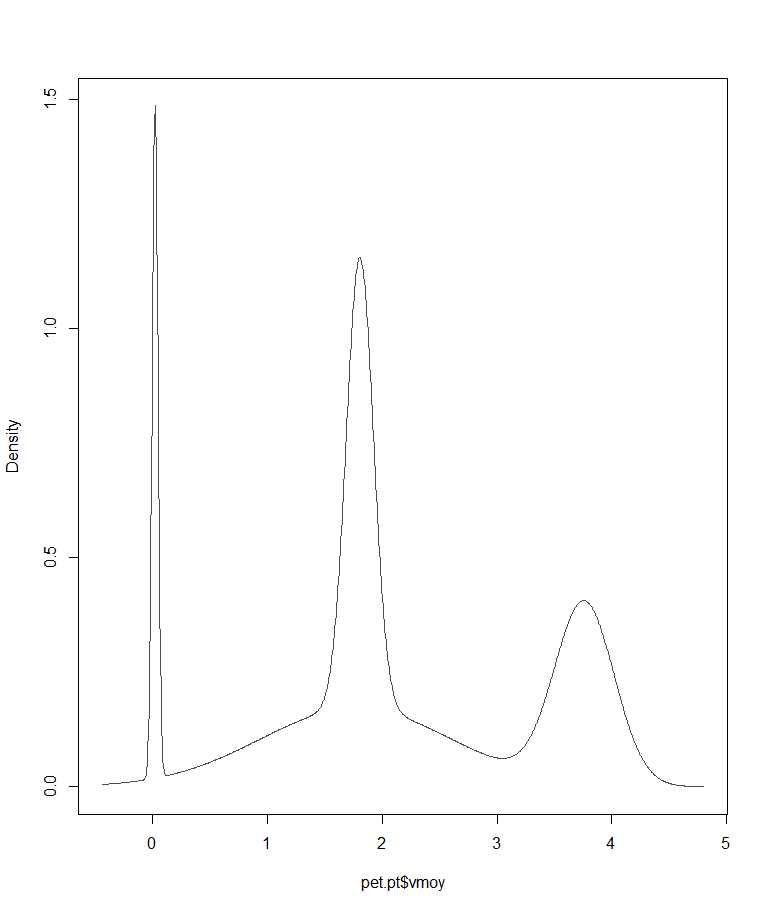
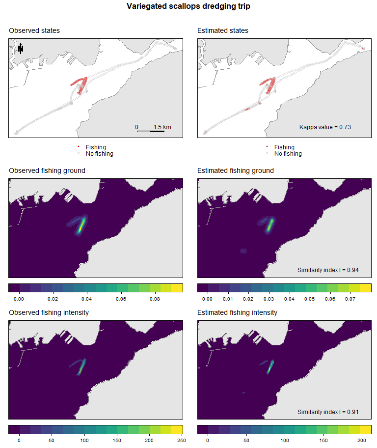

Reproducing the method evaluation
================
Damien Le Guyader

This work is described in the following publication : Le Guyader et al.
(2017)

``` r
# Script and data to reproduce mss Figure S3 for the MS

library(sp)
library(raster)
library(sf)
library(rasterVis)
library(adehabitatLT)
library(trip)
library(mclust)
library(ggplot2)
library(plyr)
library(dplyr)
library(caret)
library(viridis)
library(grid)
library(gridExtra)
library(latticeExtra)
library(spatstat.geom)
library(spatstat.explore)
```

``` r
############################ Parameters ##########################

dtm <- 600   # Maximum duration allowed between two positions (seconds)
lhsv <- 47   # Grid size calculated for the 2011-2012 season (meters)
maille <- 50 # Smoothing factor (meters)


############################ Import data #########################

# GPS data have been anonymized and coordinates translated for confidentiality

pet <- read.csv2("data/DataTripOneAnon.csv")
pet$time <- as.POSIXct(pet$time, tz = "UTC")

# Convert GPS data to a SpatialPointsDataFrame
pet_sf <- st_as_sf(
  pet,
  coords = c("coords.x", "coords.y"),
  crs = 2154,
  remove = FALSE
)

pet <- as(pet_sf, "Spatial")
sp::proj4string(pet) <- sp::CRS(SRS_string = "EPSG:2154")


# Create the clipping polygon from fishing positions
e <- raster::extent(pet) + 2000

CP <- as(e, "SpatialPolygons")
sp::proj4string(CP) <- sp::CRS(SRS_string = "EPSG:2154")
CP_sf <- st_as_sf(CP)


# Import and clip coastline data
land_sf <- st_read("data/land.shp", quiet = TRUE)
land_sf <- st_transform(land_sf, 2154)
land_sf <- st_make_valid(land_sf)
land_sf <- st_intersection(land_sf, CP_sf)
```

    ## Warning: attribute variables are assumed to be spatially constant throughout
    ## all geometries

``` r
land <- as(land_sf, "Spatial")


# Import and clip sea data
sea_sf <- st_read("data/sea.shp", quiet = TRUE)
sea_sf <- st_transform(sea_sf, 2154)
sea_sf <- st_make_valid(sea_sf)
sea_sf <- st_intersection(sea_sf, CP_sf)
```

    ## Warning: attribute variables are assumed to be spatially constant throughout
    ## all geometries

``` r
sea <- as(sea_sf, "Spatial")


################ 1 - Estimates of fishing activity ################

## Data cleaning: time filter

prep.fun <- function(x, dtmax, analyse) {
  
  # Calculate distance, duration and mean speed between consecutive positions
  
  coords <- sp::coordinates(x)
  df <- x@data
  
  # Ensure coordinate columns are available in the data
  df$coords.x <- coords[, 1]
  df$coords.y <- coords[, 2]
  
  d.ltraj <- adehabitatLT::as.ltraj(
    xy = coords,
    date = df$time,
    id = rep(analyse, nrow(df))
  )
  
  ld.ltraj <- adehabitatLT::ld(d.ltraj)
  
  df$dist <- ld.ltraj$dist
  df$dt <- ld.ltraj$dt
  
  df <- df[!is.na(df$dt) & df$dt < dtmax, ]
  df$vmoy <- df$dist / df$dt
  
  # Rebuild the SpatialPointsDataFrame
  spdf <- SpatialPointsDataFrame(
    coords = as.matrix(df[, c("coords.x", "coords.y")]),
    data = df,
    proj4string = CRS(SRS_string = "EPSG:2154")
  )
  
  return(spdf)
}

pet.pt <- prep.fun(
  x = pet,
  dtmax = dtm,
  analyse = "Varieg. scall"
)


# Speed clustering
densy <- mclust::densityMclust(pet.pt$vmoy)
```

<!-- -->

``` r
densy$modelName  # Optimal model
```

    ## [1] "V"

``` r
densy$G          # Optimal number of clusters according to BIC
```

    ## [1] 4

``` r
# Fit the Gaussian mixture model
yclust <- mclust::Mclust(
  pet.pt$vmoy,
  modelNames = densy$modelName,
  G = densy$G
)

# Combine clusters
CLUSTCOMBI <- mclust::clustCombi(yclust)
# No elbow in the NDE value; use the optimal number of clusters from BIC

yclust <- mclust::Mclust(
  pet.pt$vmoy,
  modelNames = densy$modelName,
  G = densy$G
)

pet.pt$CLUST <- yclust$classification


## Classify fishing and non-fishing positions

fishSet.fun <- function(x, minClus, maxClus) {
  
  # Identify fishing activity from the selected speed clusters
  
  vmin.clust <- min(x$vmoy[x$CLUST == minClus], na.rm = TRUE)
  vmax.clust <- max(x$vmoy[x$CLUST == maxClus], na.rm = TRUE)
  
  x$estim <- 0
  x$estim[x$vmoy >= vmin.clust & x$vmoy <= vmax.clust] <- 1
  
  x$act_estim <- "NO"
  x$act_estim[x$estim == 1] <- "FISH"
  x$act_estim <- factor(x$act_estim)
  
  return(x)
}

pet.pt <- fishSet.fun(
  pet.pt,
  minClus = 2,
  maxClus = 2
)

# Convert activity variables to factors
pet.pt$act_obs <- factor(
  pet.pt$act_obs,
  levels = c("FISH", "NO"),
  labels = c("Fishing", "No fishing")
)

pet.pt$act_estim <- factor(
  pet.pt$act_estim,
  levels = c("FISH", "NO"),
  labels = c("Fishing", "No fishing")
)

# Confusion matrix
confMat <- caret::confusionMatrix(
  table(
    Estimated = pet.pt$act_estim,
    Observed = pet.pt$act_obs
  ),
  positive = "Fishing"
)

rm(densy, CLUSTCOMBI, yclust)


################ 2 - Fishing grounds #############################

## Prepare observed and estimated values

pet.df <- as.data.frame(pet.pt)
coords <- sp::coordinates(pet.pt)

pet.df$coords.x <- coords[, 1]
pet.df$coords.y <- coords[, 2]

val.obs <- subset(
  pet.df,
  select = c(coords.x, coords.y, time, id, obs)
)
names(val.obs) <- c("x", "y", "date", "id", "statut")

val.est <- subset(
  pet.df,
  select = c(coords.x, coords.y, time, id, estim)
)
names(val.est) <- c("x", "y", "date", "id", "statut")


## Prepare trip groups

fun.group <- function(x) {
  
  x %>%
    arrange(id, date) %>%
    mutate(gap = c(0, (diff(statut) != 0) * 1)) %>%
    mutate(group = cumsum(gap) + 1)
}

val.obs <- plyr::ddply(
  val.obs,
  .(id, as.Date(date)),
  .fun = fun.group
)

val.est <- plyr::ddply(
  val.est,
  .(id, as.Date(date)),
  .fun = fun.group
)


## Create unique trip identifiers

val.obs$mmsi <- val.obs$id
val.obs$id <- paste(
  val.obs$mmsi,
  as.integer(as.Date(val.obs$date)),
  val.obs$group,
  sep = "_"
)

val.est$mmsi <- val.est$id
val.est$id <- paste(
  val.est$mmsi,
  as.integer(as.Date(val.est$date)),
  val.est$group,
  sep = "_"
)


## Keep fishing positions only

val.obs <- val.obs %>%
  filter(statut == 1) %>%
  dplyr::select(x, y, date, id)

val.est <- val.est %>%
  filter(statut == 1) %>%
  dplyr::select(x, y, date, id)


## Remove trips with fewer than three positions

lenst.obs <- table(val.obs$id)
val.obs <- val.obs[val.obs$id %in% names(lenst.obs)[lenst.obs > 2], ]

lenst.est <- table(val.est$id)
val.est <- val.est[val.est$id %in% names(lenst.est)[lenst.est > 2], ]


## Convert observed fishing positions to trip format

coordinates(val.obs) <- ~x + y
sp::proj4string(val.obs) <- CRS(SRS_string = "EPSG:2154")

trip.obs <- trip::trip(val.obs, c("date", "id"))
```

    ## Warning in force_internal(obj, TORnames): ordering input records by trip ID,
    ## then time

``` r
## Convert estimated fishing positions to trip format

coordinates(val.est) <- ~x + y
sp::proj4string(val.est) <- CRS(SRS_string = "EPSG:2154")

trip.est <- trip::trip(val.est, c("date", "id"))
```

    ## Warning in force_internal(obj, TORnames): ordering input records by trip ID,
    ## then time

``` r
pet.est <- trip.est
pet.obs <- trip.obs

rm(trip.est, trip.obs, val.obs, val.est)


## Function to compute KDE line density

fishGround.fun <- function(fishTrip, sea, grid, h) {
  
  # Prepare the sea window and raster grid
  
  owin.sea <- spatstat.geom::as.owin(sf::st_as_sf(sea))
  
  bif <- raster::raster(sea, resolution = grid)
  raster::crs(bif) <- "EPSG:2154"
  bif <- raster::mask(bif, sea)
  
  # Prepare fishing trajectories
  
  t.obs <- fishTrip
  t.obs$jour <- as.Date(t.obs$date)
  
  psp.obs.tx <- spatstat.geom::as.psp(t.obs)
  psp.obs.tx$window <- owin.sea
  
  # Estimate fishing-ground line density
  
  dk.lx.obs <- spatstat.explore::density.psp(
    psp.obs.tx,
    sigma = h,
    dimyx = c(nrow(bif), ncol(bif))
  )
  
  dk.obs <- raster::raster(dk.lx.obs)
  raster::crs(dk.obs) <- "EPSG:2154"
  
  return(dk.obs)
}


## Compute fishing grounds

pet.dk.obs <- fishGround.fun(
  fishTrip = pet.obs,
  sea = sea,
  grid = maille,
  h = lhsv
)

pet.dk.est <- fishGround.fun(
  fishTrip = pet.est,
  sea = sea,
  grid = maille,
  h = lhsv
)


################ 3 - Fishing intensity ##########################

## Function to compute fishing time spent

fishInt.fun <- function(fishTrip, sea, grid) {
  
  # Create the grid and mask it to the sea polygon
  
  bif.trip <- raster::raster(sea, resolution = grid)
  
  bif.trip[] <- round(
    runif(nrow(bif.trip) * ncol(bif.trip)) * 100
  )
  
  bif.trip <- raster::mask(bif.trip, sea)
  
  # Convert the raster to a spatial grid
  
  bif.trip.grid <- as(bif.trip, "SpatialGridDataFrame")
  bif.trip.gt <- slot(bif.trip.grid, "grid")
  
  # Calculate time spent per grid cell
  
  tripgrid <- trip::tripGrid(
    fishTrip,
    grid = bif.trip.gt,
    method = "pixellate"
  )
  
  time.t <- raster::raster(tripgrid)
  raster::crs(time.t) <- "EPSG:2154"
  
  time.est <- raster::mask(time.t, sea)
  
  return(time.est)
}


## Calculate fishing intensity

pet.time.obs <- fishInt.fun(
  fishTrip = pet.obs,
  sea = sea,
  grid = maille
)

pet.time.est <- fishInt.fun(
  fishTrip = pet.est,
  sea = sea,
  grid = maille
)


################ 4 - Warren's similarity index ###################

## Function to compute the similarity index

evalMeth.fun <- function(x, y) {
  
  # Extract raster values
  a <- raster::values(x)
  b <- raster::values(y)
  
  # Check that rasters have the same number of cells
  if (length(a) != length(b)) {
    stop("Rasters must have the same number of cells.")
  }
  
  # Keep valid cells
  ok <- is.finite(a) & is.finite(b)
  a <- abs(a[ok])
  b <- abs(b[ok])
  
  # Check for non-zero totals
  if (sum(a) == 0 || sum(b) == 0) {
    stop("Cannot calculate similarity: raster sum is zero.")
  }
  
  # Normalize values into probability distributions
  p <- a / sum(a)
  q <- b / sum(b)
  
  # Warren's I similarity index
  I <- 1 - 0.5 * sum(
    (p - q)^2 / (p + q),
    na.rm = TRUE
  )
  
  return(I)
}


## Evaluate fishing grounds and intensity

pet.ground.eval <- evalMeth.fun(
  pet.dk.obs,
  pet.dk.est
)

pet.intens.eval <- evalMeth.fun(
  pet.time.obs,
  pet.time.est
)


################ 5 - Maps ########################################

## Base map 

basemap <- list(
  "sp.polygons",
  land,
  fill = "gray90",
  col = "gray60",
  lwd = 1
)

north <- list(
  "SpatialPolygonsRescale",
  layout.north.arrow(type = 1),
  offset = c(146100, 6835650),
  scale = 600
)

scale <- list(
  "SpatialPolygonsRescale",
  layout.scale.bar(),
  scale = 1500,
  offset = c(152600, 6831350),
  fill = c("transparent", "black")
)

text1 <- list("sp.text", c(152600, 6831650), "0")
text2 <- list("sp.text", c(154000, 6831650), "1.5 km")

ext.x <- c(raster::extent(pet.pt)[1], raster::extent(pet.pt)[2])
ext.y <- c(raster::extent(pet.pt)[3], raster::extent(pet.pt)[4])

valKappa <- list(
  "sp.text",
  c(152600, 6831650),
  paste0("Kappa value = ", round(confMat$overall[2], 2))
)


## Observed states

p1 <- spplot(
  pet.pt,
  "act_obs",
  col.regions = c("red", "transparent"),
  edge.col = "grey80",
  alpha = 0.5,
  cex = 0.5,
  lwd = 0.8,
  legendEntries = c("Fishing", "No fishing"),
  key.space = "bottom",
  par.settings = list(fontsize = list(text = 9)),
  sp.layout = list(basemap, north, scale, text1, text2),
  main = list(
    label = "Observed states",
    font = 1,
    just = "left",
    x = grid::unit(5, "mm")
  )
)


## Estimated states

p2 <- spplot(
  pet.pt,
  "act_estim",
  col.regions = c("red", "transparent"),
  edge.col = "grey80",
  alpha = 0.5,
  cex = 0.5,
  lwd = 0.8,
  legendEntries = c("Fishing", "No fishing"),
  key.space = "bottom",
  par.settings = list(fontsize = list(text = 9)),
  sp.layout = list(basemap, valKappa),
  main = list(
    label = "Estimated states",
    font = 1,
    just = "left",
    x = grid::unit(5, "mm")
  )
)


## Observed fishing grounds

p3 <- rasterVis::levelplot(
  pet.dk.obs,
  xlim = ext.x,
  ylim = ext.y,
  margin = FALSE,
  xlab = NULL,
  ylab = NULL,
  scales = list(draw = FALSE),
  col.regions = viridis::viridis,
  colorkey = list(space = "bottom"),
  main = list(
    label = "Observed fishing ground",
    font = 1,
    just = "left",
    x = grid::unit(5, "mm")
  ),
  par.settings = list(fontsize = list(text = 9))
) +
  latticeExtra::layer(
    sp::sp.polygons(land, fill = "gray90", col = "gray50")
  )


## Estimated fishing grounds

p4 <- rasterVis::levelplot(
  pet.dk.est,
  xlim = ext.x,
  ylim = ext.y,
  margin = FALSE,
  xlab = NULL,
  ylab = NULL,
  scales = list(draw = FALSE),
  col.regions = viridis::viridis,
  colorkey = list(space = "bottom"),
  main = list(
    label = "Estimated fishing ground",
    font = 1,
    just = "left",
    x = grid::unit(5, "mm")
  ),
  par.settings = list(fontsize = list(text = 9))
) +
  latticeExtra::layer(
    sp::sp.polygons(land, fill = "gray90", col = "gray50")
  ) +
  latticeExtra::layer(
    sp::sp.text(
      c(152600, 6831650),
      paste0("Similarity index I = ", round(pet.ground.eval, 2))
    )
  )


## Observed fishing intensity

p5 <- rasterVis::levelplot(
  pet.time.obs,
  xlim = ext.x,
  ylim = ext.y,
  margin = FALSE,
  xlab = NULL,
  ylab = NULL,
  scales = list(draw = FALSE),
  col.regions = viridis::viridis,
  colorkey = list(space = "bottom"),
  main = list(
    label = "Observed fishing intensity",
    font = 1,
    just = "left",
    x = grid::unit(5, "mm")
  ),
  par.settings = list(fontsize = list(text = 9))
) +
  latticeExtra::layer(
    sp::sp.polygons(land, fill = "gray90", col = "gray50")
  )


## Estimated fishing intensity

p6 <- rasterVis::levelplot(
  pet.time.est,
  xlim = ext.x,
  ylim = ext.y,
  margin = FALSE,
  xlab = NULL,
  ylab = NULL,
  scales = list(draw = FALSE),
  col.regions = viridis::viridis,
  colorkey = list(space = "bottom"),
  main = list(
    label = "Estimated fishing intensity",
    font = 1,
    just = "left",
    x = grid::unit(5, "mm")
  ),
  par.settings = list(fontsize = list(text = 9))
) +
  latticeExtra::layer(
    sp::sp.polygons(land, fill = "gray90", col = "gray50")
  ) +
  latticeExtra::layer(
    sp::sp.text(
      c(152600, 6831650),
      paste0("Similarity index I = ", round(pet.intens.eval, 2))
    )
  )


## Arrange and display maps

gridExtra::grid.arrange(
  p1, p2, p3, p4, p5, p6,
  nrow = 3,
  ncol = 2,
  top = grid::textGrob(
    "Variegated scallops dredging trip\n",
    gp = grid::gpar(fontsize = 12, font = 2)
  )
)
```

<!-- -->

## References

<div id="refs" class="references csl-bib-body hanging-indent">

<div id="ref-leguyader2017c" class="csl-entry">

Le Guyader, Damien, Cyril Ray, Françoise Gourmelon, and David Brosset.
2017. “Defining High-Resolution Dredge Fishing Grounds with Automatic
Identification System (AIS) Data.” *Aquatic Living Resources* 30 (39).
<https://doi.org/10.1051/alr/2017038>.

</div>

</div>
